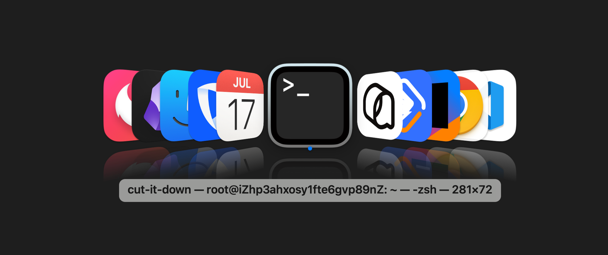

# AltTabLite

A lightweight, Windows-style Alt+Tab window switcher for macOS, with List and Cover Flow layouts.



Requires macOS 13 or later. The current prebuilt release supports Apple Silicon (arm64) only.

## Installation

1. Download `AltTabLite-<version>.zip` and its matching `.sha256` file from [Releases](https://github.com/hxchjm/AltTabLite/releases).
2. Optionally verify the download from the directory containing both files (replace `<version>` with the actual version):
   ```bash
   shasum -a 256 -c AltTabLite-<version>.zip.sha256
   ```
3. Unzip the archive and drag `AltTabLite.app` into your Applications folder.
4. Open the app for the first time. It is ad-hoc signed and **not notarized by Apple**, so macOS may display a warning that the developer cannot be verified:
   - **macOS 15 and later:** Double-click the app once and dismiss the warning. Then go to **System Settings → Privacy & Security**, click **Open Anyway**, and authenticate when prompted.
   - **macOS 13–14:** Right-click the app in Finder, choose **Open**, and confirm by clicking **Open** again.
5. Allow AltTabLite in **System Settings → Privacy & Security → Accessibility** so it can listen for shortcuts and switch windows.

If these steps do not work, you can manually remove the download quarantine attribute. Only do this after confirming that the app came from this repository's Releases and that you trust it:

```bash
xattr -dr com.apple.quarantine /Applications/AltTabLite.app
```

## Updating

Quit AltTabLite, then replace `/Applications/AltTabLite.app` with the new version. Because the ad-hoc signature changes with each build, you may need to grant Accessibility permission again:

1. In **System Settings → Privacy & Security → Accessibility**, select AltTabLite and click **−** to remove it.
2. Reopen AltTabLite and grant permission again when prompted.

## Building from Source

Install Xcode or the Command Line Tools (`xcode-select --install`).

```bash
git clone https://github.com/hxchjm/AltTabLite.git
cd AltTabLite
CODE_SIGN_IDENTITY="-" ./build.sh
open build/AltTabLite.app
```

By default, `build.sh` uses a local signing certificate named `AltTabLite Dev`. Using a stable local certificate can help preserve Accessibility permission across development builds. Set `CODE_SIGN_IDENTITY="-"` to use ad-hoc signing instead.

## Release Packaging

```bash
./release.sh
```

The script builds an ad-hoc signed app and creates `AltTabLite-<version>.zip` and its `.sha256` checksum file in `dist/`. Upload both files to GitHub Releases. The version is read from `CFBundleShortVersionString` in `Info.plist`.
